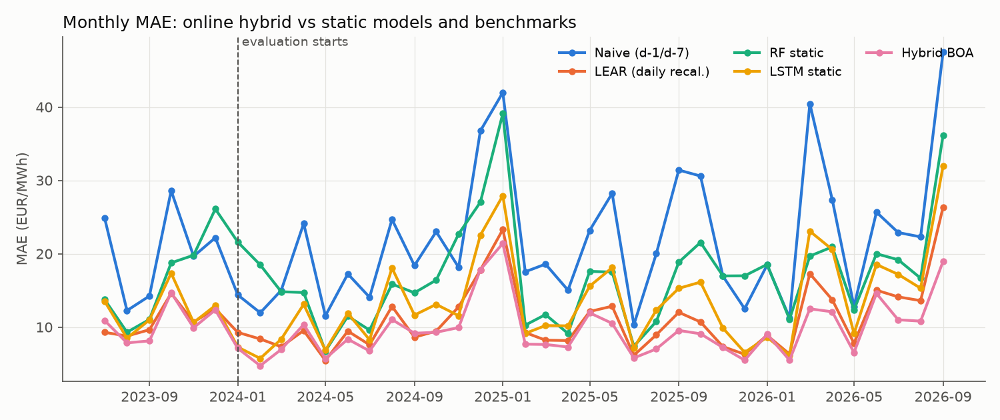
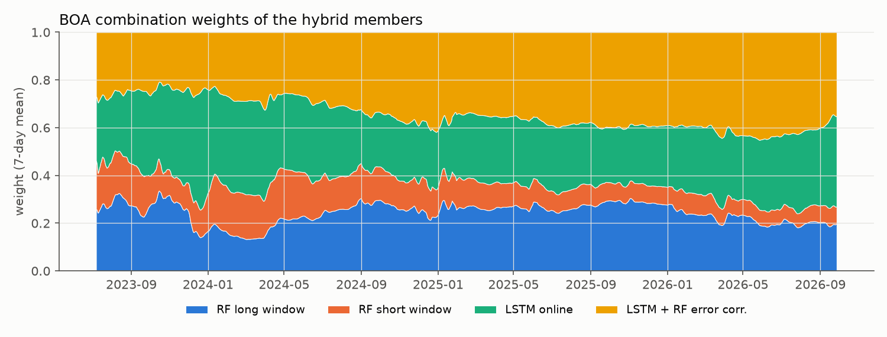
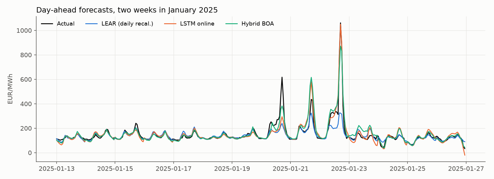
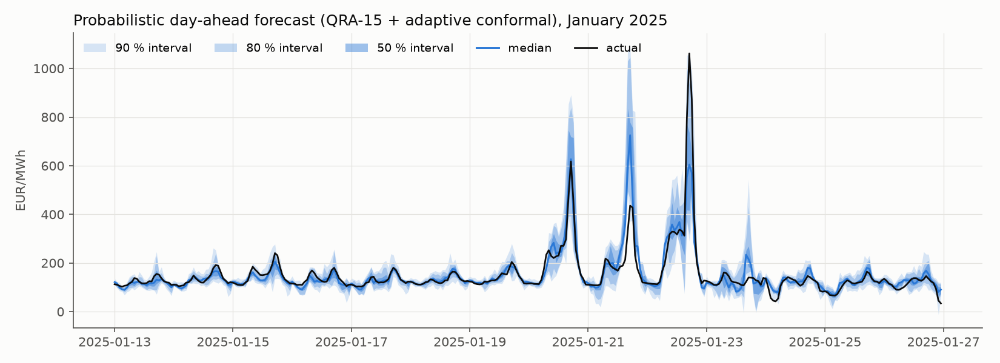
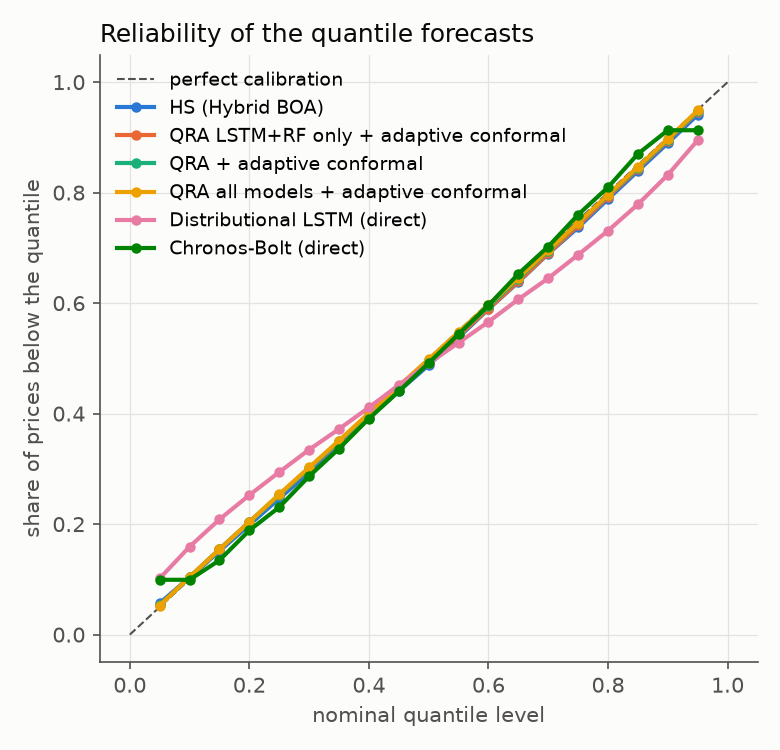

# Online Ensemble Forecasting of GB Day-Ahead Electricity Prices

A continually retrained ensemble of 13 forecasting models for the Great Britain day-ahead market,
combined with Bernstein Online Aggregation, with calibrated quantiles and a live daily forecast.

**Live forecast:** https://timlouiswilken.github.io/gb-dayahead-forecast/ (published every morning before gate closure)

## Headline results

Out of sample, 2024-01-01 → 2026-09-27, strict 07:30 UTC D-1 information set:

| | Result |
|---|---|
| Point forecast, **Hybrid BOA over all 13 members** | MAE **8.73 EUR/MWh**, 21 % below the LEAR benchmark (11.07) and better than every single model (DM p < 0.001) |
| Point forecast, **6-member selection** (chosen on 2024 only, used in the live system) | MAE **8.56 EUR/MWh**, better than all 13 in every year (DM p < 0.001) |
| Quantiles, **QRA-15 + adaptive conformal** | 50 / 80 / 90 % intervals cover 49.4 / 79.5 / 89.6 % |
| **Battery backtest** (50 MW / 100 MWh, day-ahead only) | 93.1 % (2025) and 93.7 % (2026) of the perfect-foresight arbitrage revenue, against 89.9 / 90.4 % for LEAR |
| Largest single gain | continual learning: online RF 11.58 vs the same model trained once 17.12 |

## Background

**Idea.** In this setting, neither a deep model nor a tree ensemble wins on its own. Prices drift between
regimes (the 2021–22 crisis, then 2024–25 normalisation), so every model has to keep learning from the
newest data. The project started as an *online* hybrid of four core members:

| Member | Role | Continual-learning mechanism |
|---|---|---|
| `lstm` | Seq2seq LSTM: 7-day hourly history → 24 delivery hours | cold fit every 91 days; **daily warm-start fine-tuning** with **experience replay**; RevIN normalisation |
| `rf_long` | Random forest, 3-year window | weekly refit, exponential recency weights (half-life 365 d) |
| `rf_short` | Random forest, 84-day window | daily refit (reacts fast to regime changes) |
| `lstm_rf` | LSTM + RF **error correction** | RF learns the LSTM's out-of-sample errors, weekly refit |
| **Hybrid BOA** | final forecast | per-hour **Bernstein Online Aggregation** of the four members, weights updated every day |

**Additional members** (same online protocol, added in the "try everything" round):

| Member | Model | Online scheme |
|---|---|---|
| `gbm` | Histogram gradient boosting, **absolute** loss (squared loss chased the 2022 crisis: MAE 18.3 vs 13.7 on burn-in) | weekly refit, 3-year window, recency weights, early stopping on the newest 10 % of days; runs with the extra predictors (`EXTRA_FEATS=2`) |
| `tcn` | Temporal convolutional network (Bai et al., 2018) | like `lstm`: daily fine-tuning + replay, cold retrain every 91 d |
| `transformer` | encoder–decoder Transformer (2+2 layers, d=64) | like `lstm` |
| `dnn` | MLP (Lago-style DNN) | like `lstm` |
| `ddnn` | **distributional** LSTM, Johnson-SU output (Marcjasz et al., 2023) | like `lstm`; also stores its 19 quantiles |
| `lear4` | LEAR over 4 windows (56/84/1092/1456 d) | daily recalibration |
| `merit` | merit-order regression: residual-load spline × CCGT fuel cost | daily refit, 182-d window |
| `chronos` | Chronos-Bolt small (Ansari et al., 2024), **zero-shot**, 28-day price context | no training at all |

Benchmarks: naive (Lago et al., 2021), **LEAR** with daily recalibration (182/728-day windows averaged),
and *static* RF / LSTM that are trained once and never updated (the continual-learning ablation).
Final products: **Hybrid BOA all models** (BOA over all 13 members) for the point forecast and
**QRA-15 + adaptive conformal** for the quantiles (QRA over all 13 members plus two dedicated GBM tail forecasts).

---

## Data (v2, refreshed 2026-10-09)

`python src/update_data.py` downloads every input up to the latest available day. 

Renewables are **not modelled**. The model uses the system operator's own wind and solar forecasts,
taking the issue that existed before the auction, and spends all its capacity on the price.

| Input | Source | Issue / availability rule |
|---|---|---|
| GB day-ahead prices (EUR/MWh) | [Ember](https://ember-energy.org/data/european-wholesale-electricity-price-data), hourly | local days ≤ D-1 |
| Transmission wind forecast | Elexon/NESO **WINDFOR** (`/forecast/generation/wind/history`) | latest issue ≤ 07:30 UTC on D-1 |
| Embedded wind & solar forecast | [NESO embedded forecasts](https://api.neso.energy/api/3/action/package_show?id=embedded-wind-and-solar-forecasts), yearly archives | latest issue ≤ 07:30 UTC on D-1 |
| Temperature forecast (Birmingham) | Open-Meteo Previous Runs, JMA, `temperature_2m_previous_day2` | forecast made 48 h before each valid hour |
| **National demand forecast (NDF)** | Elexon/NESO `datasets/NDF` | latest issue ≤ **09:00 UK time** on D-1. The full-day issue appears at 08:45 UK time, before the EPEX (09:20) and N2EX (09:50) gate closures |
| National demand outturn | [NESO historic demand data](https://api.neso.energy/api/3/action/package_show?id=historic-demand-data) | local days ≤ D-2 (extra features: same hour D-7 and D-2) |
| Gas SAP (p/kWh) | [ONS / National Gas](https://www.ons.gov.uk/economy/economicoutputandproductivity/output/datasets/systemaveragepricesapofgas) | gas day D-3 (conservative) |
| UK ETS (UKA) futures, GBP/t | investing.com "UK Emissions Allowances Energy c1" CSV export in `data/manual/` (there is no free API) | settlement of D-2 |
| TTF front-month, EUR/MWh (`EXTRA_FEATS=2`, used by `gbm`) | Yahoo Finance `TTF=F` | settlement of trading day D-2 |
| EUA futures, EUR/t (`EXTRA_FEATS=2`, used by `gbm`) | investing.com export (investing.com "Carbon Emissions Futures" export) | settlement of D-2 |
| Wind outturn (transmission), for the forecast-error features (`EXTRA_FEATS=2`) | Elexon **AGWS** (`/generation/actual/per-type/wind-and-solar`) | published ~90 min after each half hour; only publications ≤ 07:30 UTC on X+1 are stored, used with lags ≥ 2 days |
| Neighbour day-ahead prices FR/NL/BE/NO/IE/DK/DE (`EXTRA_FEATS=1`, **not** used in production) | same Ember zip | SDAC of delivery day D-1 clears ~12:45 CET on D-2 |

**Live top-ups** (for the daily live forecast, `src/live.py`): the bulk sources above lag reality —
Ember by days to weeks, the NESO demand file by weeks. Three light steps bridge the gap to "now"
and are merged by `data.py` strictly *after* the end of the corresponding bulk file:

| Live input | Source | Check against the bulk source |
|---|---|---|
| GB day-ahead prices | Nord Pool data portal, N2EX auction results in EUR (`api/DayAheadPrices`) | mean diff 0.05 EUR/MWh, max < 4 EUR on overlap days |
| National demand outturn | Elexon **INDO** (`/demand/outturn`) | mean diff ~7 MW on ~24 GW |
| Embedded wind & solar | NESO datastore SQL API (same archive table, incremental query) | identical rows; the same ≤ 07:30 UTC D-1 issue rule is applied |

One subtlety: Nord Pool serves CET-aligned days, so the last 1–2 hours of UK day D-1 appear only
on the next auction page although they cleared a day earlier. In live mode (`extend_to`) such
end-of-day gaps (≤ 3 h) are filled within the day **for the lag features only**; `y` stays raw.

## Forecasting set-up and leakage audit

Before the GB day-ahead auctions close on D-1 (~09:20 UK time), the 24 hourly prices of
**local (UK) delivery day D** are forecast. The decision time is 07:30 UTC on D-1. DST days are
mapped to 24 hours, as in epftoolbox: the missing spring hour is interpolated and the doubled
autumn hour is averaged.

**Leaks found and fixed:**

| # | Where | Problem | Fix |
|---|---|---|---|
| 1 | common pattern | `Price_Roll_Mean_24` (`closed='left'`) contains same-day prices of D | price lags only from complete days ≤ D-1 |
| 2 | common pattern | gas/CO₂ lagged by 1 day, demand `shift(24)` | gas D-3, CO₂ D-2, demand ≤ D-2 |
| 3 | v1 of this project | `weather_final.csv` is **ERA5 reanalysis = actual weather** (Open-Meteo archive API) | temperature forecast made 48 h ahead |
| 4 | v1 | Open-Meteo `previous_day1` = forecast made 24 h before *each hour*, i.e. issued during D-1, after the auction | `previous_day2` |
| 5 | v1 | Elexon DGWS wind/solar "day-ahead" forecasts are always published **16:45 UTC on D-1**, after the auction | WINDFOR + NESO embedded issues ≤ 07:30 UTC |
| 6 | v1 | **UTC days instead of local days.** In summer the input hour 23:00 UTC of D-1 is 00:00 BST of D, so it came from the very auction being forecast | local delivery days |
| 7 | v1 | gap filling by interpolation used later values | causal fill from earlier days only |
| – | unit bug | gas SAP is p/kWh, not GBP/therm | CCGT cost = `SAP × 10 / 0.5 + 0.37 × UKA` GBP/MWh_el |
| – | data bug | a file labelled "UK ETS" turned out to be the **EU ETS (EUA)** price: it starts on 4 Jan 2021 at 33.89, before UKA futures existed, and runs 1.46× above UKA | UKA from investing.com; EUA (rescaled) only before UKA's first quote |
| 8 | extra features | Elexon AGWS stores **late revisions**: 114 of 97k half hours were (re-)published after the 07:30-UTC cutoff of the day they would be used for | `update_data.py` keeps only publications before each value's own cutoff; found by the issue-time check itself |

**Automated check:** `python src/test_leakage.py` (runs on the feature **superset**, `EXTRA_FEATS=3`).
1. **Perturbation test.** For several days, including both DST switch days, it scrambles every value
   that was unknown at the decision time: prices and neighbour prices from D on, demand and wind
   outturn from D-1 on, gas from D-2 on and CO₂/TTF/EUA from D-1 on. It then asserts that the model
   inputs for D are bit-identical.
2. **Positive control.** It also scrambles the allowed D-1 prices, to prove the test detects changes.
3. **Issue-time check.** It verifies that no forecast value was issued after the cutoff.

**Training protocol** (also leakage-checked):
- Day t is trained only on days < t.
- Scalers and early stopping use training days only.
- The error-correction RF learns only from out-of-sample LSTM errors.
- BOA weights are updated only after the day's prices are known.
- Hyper-parameters were chosen on the 2023-H2 burn-in only.

**Remaining, minor:** NESO demand files contain final settlement values. Real-time initial
outturn (INDO) can differ slightly. The effect is small, and the values are used with a 2-day lag.

Online protocol: the models are first fitted on all days from 2021-07-07 to 2023-06-30 (≈ 2 years). Every
day from then on, each member forecasts the next day and then learns from it. 2023-H2 is a
**burn-in period** that warms up the combiner and the error-correction stage. All reported results
cover **2024-01-01 onwards**, which no design choice has seen.

## Results

Out-of-sample results for **2024-01-01 → 2026-09-27** (≈ 1,000 local days × 24 h), in EUR/MWh, with the NDF demand forecast.
rMAE is the MAE relative to the naive forecast.

| Model | MAE | RMSE | rMAE | sMAPE % |
|---|---|---|---|---|
| Naive (d-1/d-7) | 21.90 | 37.22 | 1.000 | 32.2 |
| RF static (trained once) | 17.12 | 26.94 | 0.782 | 24.0 |
| Chronos-Bolt (zero-shot) | 14.44 | 25.89 | 0.660 | 21.3 |
| LSTM static (trained once) | 13.50 | 22.03 | 0.617 | 20.9 |
| RF short window (online) | 12.65 | 21.03 | 0.578 | 20.0 |
| Merit-order regression | 12.24 | 19.97 | 0.559 | 19.4 |
| LEAR 4 windows | 12.19 | 70.97 | 0.557 | 18.2 |
| RF long window (online) | 11.58 | 19.08 | 0.529 | 18.7 |
| DNN (Lago-style) online | 11.33 | 23.89 | 0.517 | 17.7 |
| **LEAR, daily recalibration** (benchmark) | 11.07 | 20.11 | 0.506 | 17.5 |
| TCN online | 11.06 | 23.50 | 0.505 | 17.4 |
| Gradient boosting (weekly refit) | 10.79 | 18.92 | 0.493 | 17.5 |
| LSTM online | 10.69 | 18.16 | 0.488 | 17.6 |
| LSTM + RF error correction | 10.37 | 17.33 | 0.474 | 17.1 |
| Distributional LSTM (JSU) | 10.19 | 17.93 | 0.465 | 16.7 |
| **Transformer online** (best single model) | **9.78** | 17.88 | 0.446 | 16.6 |
| Hybrid, equal weights (4 members) | 9.79 | 16.32 | 0.447 | 16.3 |
| Hybrid, inverse-MAE weights | 9.69 | 16.29 | 0.443 | 16.2 |
| Hybrid BOA (LSTM + RF, 4 members) | 9.63 | 16.18 | 0.440 | 16.2 |
| Hybrid BOA + LEAR (5) | 9.17 | 15.96 | 0.419 | 15.5 |
| Hybrid BOA all ML (9) | 9.06 | 16.23 | 0.414 | 15.5 |
| Equal weights, all models (13) | 9.15 | 17.29 | 0.418 | 15.4 |
| **Hybrid BOA all models (13)** | **8.73** | 16.40 | 0.399 | 14.9 |
| **Hybrid BOA selected 6** (ablation, see finding 8) | **8.57** | **15.72** | **0.391** | **14.7** |

MAE by year:

| | 2024 | 2025 | 2026 (→ Sep) |
|---|---|---|---|
| Naive | 19.14 | 22.20 | 25.23 |
| LEAR | 9.87 | 10.42 | 13.56 |
| Transformer online | 9.13 | 9.52 | 10.99 |
| Hybrid BOA (4) | 8.95 | 9.17 | 11.15 |
| Hybrid BOA + LEAR | 8.49 | 8.77 | 10.63 |
| Hybrid BOA all models | 7.95 | 8.63 | 9.92 |
| **Hybrid BOA selected 6** | **7.84** | **8.32** | **9.88** |

Main findings. One-sided Diebold–Mariano p-values are in `outputs/dm_pvalues.csv`.

1. **Continual learning is the largest single gain.**
   - RF: online 11.58 vs static 17.12 (−32 %).
   - LSTM: online 10.69 vs static 13.50 (−21 %).
   - Both p < 0.001. The static models degrade year by year; the online models do not.
2. **Already the 4-member online hybrid beats LEAR in every year:** MAE −12.5 %, RMSE −19 %,
   p < 0.001. The gap is largest in 2026 (−17 %). The full 13-member combination widens this to −21 %.
3. **The Transformer is the best single model** (9.78) — but it is *not* significantly better than
   the 4-member Hybrid BOA (p = 0.73), and the full combination beats it clearly (p < 0.001).
   TCN and DNN look fine on MAE but have fat error tails (RMSE 23.5 / 23.9 — 2025 instability);
   the combination absorbs this.
4. **RF error correction improves the LSTM:** 10.37 vs 10.69 (p = 0.006), mainly in RMSE, i.e. in the size of the spikes.
5. **Gradient boosting does not overfit online.** With weekly refits, recency weights and
   time-ordered early stopping it reaches 10.79, better than both RFs. (The decisive choice was the
   **absolute** loss; squared loss chased the 2022 spikes: 18.3.) XGBoost itself could not be used
   (libomp conflict with scikit-learn on macOS/x86); HistGradientBoosting is the same LightGBM-style algorithm.
6. **BOA weighting ≈ equal weights for the small, homogeneous pool** (9.68 vs 9.79) — but for the
   13-member pool with deliberately weak members (Chronos 14.4, merit 12.2) adaptive weighting pays:
   BOA 8.73 vs equal 9.15. Weak members are down-weighted automatically, so nothing had to be
   pre-selected (regret grows only with log N).
7. **Hybrid BOA all models beats every single model** (8.73): significantly better than every
   earlier combination and every single model (all p < 0.0001). LEAR4, merit and Chronos add little
   alone, but they do no harm inside BOA.
8. **Ablation: 6 diverse members beat all 13.** Greedy backward elimination *selected on 2024
   only* keeps exactly one member per model family — `lstm_rf, gbm, transformer, lear, merit,
   chronos` — and wins on the untouched 2025–26 holdout: MAE 8.99 vs 9.18; full period 8.56 vs 8.73
   (DM p < 0.001), better in every year and in RMSE. Redundant siblings
   (both RFs, plain LSTM, TCN, DNN, DDNN, LEAR4) dilute the BOA weights of their better twin:
   BOA's log-N regret bound protects against *bad* experts, not against *correlated* ones.
   Notably the individually weak merit (12.2) and Chronos (14.4) stay in — their errors are the
   least correlated with the rest. This matches the expert-aggregation practice at EDF
   (Gaillard & Goude: diverse experts from different statistical worlds, not many of a kind).

**Extra-predictor experiments** (both behind the `EXTRA_FEATS` env flag, tested first on the
2023-H2 burn-in, then as full online A/B reruns; rejected variants archived in
`outputs/preds_nf_experiment/` and `outputs/preds_f2_experiment/`):

| Set | Features | Online A/B result (eval 2024+) | Decision |
|---|---|---|---|
| `EXTRA_FEATS=1` | 7 neighbour DA prices (lag 1), 7-day rolling price mean/vol | every member slightly worse; hybrid 9.79 → 9.89 | **rejected** — the information is already in the GB lags / fuel cost / residual load |
| `EXTRA_FEATS=2` | TTF front-month (D-2), EUA (D-2), wind forecast error (D-2/D-3) | **gbm 10.85 → 10.79 (better in every year)**; LSTM worse (10.69 → 10.99), RFs neutral, LEAR worse on burn-in | **adopted for `gbm` only** |
| `EXTRA_FEATS=4` | population-weighted 4-city temperature, hourly HDD, daily HDD lags | rf_long burn-in better (13.48 → 13.14) but full online A/B worse (11.58 → 11.67, p = 0.92) | **rejected** — temperature is already in the demand forecast |
| `EXTRA_FEATS=5` | NESO OC2 surplus margin for D (issue of D-2), absolute + relative | rf_long full A/B 11.67 vs 11.63 (p = 0.31), 2024 exactly neutral; gbm/lstm worse on burn-in | **rejected** |
| `EXTRA_FEATS=6` | REMIT unavailable capacity for D (planned + unplanned outages incl. interconnectors, published ≤ cutoff; per-asset hourly max, dispatchable fuels) | falsified at the data level, no member run needed: planned outages **anti-correlate** with spikes (maintenance is scheduled into calm periods; 2024 spike hours 20.4 GW unavailable vs 21.8 normal), the unplanned <72 h "shock" variant shows zero discrimination, corr(price) ≈ 0 | **rejected** — outage information is already priced into the D-1 price lags |

**Effect of the NESO/BMRS demand forecast (NDF).** It replaces the D-7 outturn proxy, and the
residual load becomes fully forecast-based. The NDF is 3× more accurate than the proxy (665 vs
2,031 MW MAE against outturn). Results on the same evaluation window (one-sided DM p-values):

| | without NDF | with NDF | p |
|---|---|---|---|
| LEAR | 11.56 | 11.07 | < 0.001 |
| LSTM online | 11.02 | 10.69 | 0.008 |
| RF long window | 12.29 | 11.58 | < 0.001 |
| Hybrid BOA | 10.18 | **9.68** (−4.9 %, RMSE −7.6 %) | < 0.001 |

The static RF got worse, because its single training window now starts in July 2021 instead of January.





## Battery arbitrage backtest

`src/bess_backtest.py` asks what the forecasts are worth in EUR. A 100 MWh / 50 MW battery (2-hour,
85 % round trip) schedules each local day D with an LP on the forecast available on the morning of D-1,
commits it as price-taking day-ahead bids, and is settled at the actual clearing prices
(arbitrage gross margin, no grid fees or degradation).

| Strategy | 2025: % of perfect foresight | 2026 (Jan–Sep) | EUR/kW/yr (2026) |
|---|---|---|---|
| Perfect foresight (upper bound) | 100.0 | 100.0 | 50.4 |
| **Hybrid BOA all 13** | **93.1** | **93.7** | 47.2 |
| BOA selected 6 | 92.1 | 93.6 | 47.2 |
| LEAR | 89.9 | 90.4 | 45.6 |
| Persistence (D-1 profile) | 74.5 | 76.5 | 38.6 |

The better point forecast is worth about 3 percentage points of the attainable revenue over LEAR and
17–19 points over persistence; forecast-based schedules lost money on only 1–2 days per year.

## Probabilistic forecasts

`src/probabilistic.py` turns the online point forecasts into 19 quantiles (5 %, 10 %, …, 95 %) per hour.
It is a post-processing step: it uses only the members' out-of-sample forecasts of days < t and is
recalibrated every day on the last 182 days.

| Method | Idea |
|---|---|
| HS | Historical simulation (benchmark): Hybrid-BOA point forecast + empirical quantiles of its own past errors, per hour |
| QRA | Quantile Regression Averaging (Nowotarski & Weron, 2015): per hour and quantile, a linear quantile regression of the price on the member forecasts (LSTM, LSTM+RF, RF long, RF short, LEAR) |
| QRA + conformal | Each quantile is shifted by the matching quantile of its own past out-of-sample residuals (conformalized quantile regression, Romano et al., 2019) |
| **QRA + adaptive conformal** | As above, but the residual quantile level is adjusted after every day from the realised hit rate (adaptive conformal inference, Gibbs & Candès, 2021; γ = 0.005 from the paper, not tuned) |
| QRA all models (± adaptive conformal) | QRA over all 13 members instead of the 5 core members |
| **QRA-15** (± adaptive conformal) | QRA over all 13 members **plus two dedicated GBM tail forecasts** (pinball-loss `gbm_q10`/`gbm_q90`): mean forecasts under-spread in spike regimes, the tails inform the design matrix directly |
| Distributional LSTM / Chronos (direct) | the quantiles those models output themselves, no post-processing |

Evaluation:
- **Average pinball loss** over the 19 quantiles, a proper scoring rule ≈ CRPS/2 (Gneiting & Raftery, 2007).
- **Empirical coverage and width** of the 50/80/90 % central intervals.
- **Kupiec test.** With ~24k autocorrelated hourly hits it rejects even tiny deviations, so read the
  coverage levels themselves rather than its p-value.

Results, 2024-01-01 → 2026-09-27, with daily recalibration:

| Method | Avg pinball ↓ | 50 % cov. | 80 % cov. | 90 % cov. | 80 % width | 90 % width |
|---|---|---|---|---|---|---|
| HS (Hybrid BOA, LSTM + RF) | 3.87 | 49.2 % | 78.6 % | 88.3 % | 27.7 | 41.4 |
| QRA (5 members) | 3.67 | 45.6 % | 74.4 % | 84.6 % | 26.0 | 36.8 |
| QRA + conformal | 3.68 | 48.2 % | 77.6 % | 87.5 % | 29.2 | 42.2 |
| QRA + adaptive conformal | 3.69 | 49.2 % | 79.2 % | 89.4 % | 30.8 | 47.2 |
| QRA all models (raw) | 3.60 | 44.2 % | 72.6 % | 82.7 % | 25.0 | 35.1 |
| QRA all models + adaptive conformal | 3.62 | 49.1 % | 79.3 % | 89.6 % | 30.3 | 45.9 |
| QRA-15 (raw) | 3.58 | 44.1 % | 72.3 % | 82.9 % | 25.5 | 34.5 |
| **QRA-15 + adaptive conformal** | **3.59** | **49.4 %** | **79.5 %** | **89.6 %** | 30.3 | 43.4 |
| QRA LSTM + RF only | 3.85 | 45.7 % | 74.0 % | 84.7 % | 26.6 | 38.8 |
| QRA LSTM + RF only + adaptive conformal | 3.86 | 48.8 % | 79.1 % | 89.2 % | 31.9 | 49.3 |
| Distributional LSTM (direct) | 3.96 | 39.3 % | 67.3 % | 79.3 % | 24.8 | 34.5 |
| Chronos-Bolt (direct) | 5.61 | 52.9 % | 81.4 % | 81.4 % | 44.3 | 44.3 |

- **Plain QRA is overconfident.** Its 90 % band covers only 83–85 %. The conformal correction fixes this,
  and the adaptive version hits all nominal levels within about 1 point, at almost no cost in pinball loss.
- **QRA-15 is the best distribution**: the 13-member QRA already beats the 5-member QRA (p = 0.009);
  adding the two GBM tail forecasts improves it further (p = 0.016), mostly in spike hours
  (selection year 2024: spike q90 coverage 65 → 68 %, spike pinball −3 %; holdout confirmed, p = 0.038).
- The models' **own** distributions are too narrow on their own (DDNN covers 79 % at nominal 90 %) —
  but as members inside QRA they contribute.
- **Without LEAR, QRA adds nothing over HS** (p = 0.40). For a pure LSTM + RF model, historical
  simulation is the simpler equivalent choice.
- `outputs/forecasts_quantiles.csv` holds the quantiles of **QRA-15 + adaptive conformal**.




## Design rationale (literature)

The pre-build review is in [`docs/literature_review.md`](docs/literature_review.md); the full-text review of 25 papers with the positioning of this system is in [`docs/LITERATURE.md`](docs/LITERATURE.md) (per-paper notes in `literature/notes/`, PDFs rebuilt with `literature/download.sh`). Key points:

- **Daily recalibration** and averaging across short and long calibration windows are best practice in
  EPF (Lago et al., 2021; Marcjasz, Serafin & Weron, 2018; Hubicka, Marcjasz & Weron, 2019). This motivates
  `rf_short` + `rf_long` and the 182/728-day LEAR.
- **Exponential down-weighting** of old observations is MSFE-optimal under continuous structural change
  (Pesaran, Pick & Pranovich, 2013). This motivates the recency weights in the RF and in the LSTM loss.
- **Experience replay** limits catastrophic forgetting when fine-tuning neural nets on a stream
  (Rolnick et al., 2019). Online-updated LSTMs beat static ones on energy prices (Salihoglu et al., 2025, preprint).
- **RF error correction of a deep model** was effective for half-hourly prices (Ghimire et al., 2024).
  This motivates `lstm_rf`.
- **Online forecast combination**: BOA (Wintenberger, 2017), applied to 24-dimensional day-ahead prices
  by Berrisch & Ziel (2023). A forgetting factor (<1/day) would let weights track regime changes, but a grid search selected on 2024 and confirmed on the 2025–26 holdout (DM p = 0.001) picked **no forgetting** (forget = 1.0): the 365-day rolling weights are stable enough, and forgetting mostly adds variance. For serving, each hour's weights are averaged with its ±1-hour neighbours (selected on 2024, holdout-confirmed, both p < 0.001, −0.03 MAE): per-hour weights are noisy and adjacent delivery hours share structure; the online update itself keeps the raw per-hour weights.
- **Reversible instance normalisation** (Kim et al., 2022, ICLR) for the LSTM. Each sample is normalised
  by its own 7-day price history, so the network learns price shapes instead of regime-specific levels.
  On the burn-in period this cut the LSTM's MAE from 16.9 to 13.5 EUR/MWh.
- Prices are **asinh-transformed** to stabilise variance (Uniejewski, Weron & Ziel, 2018).
- Additional architectures follow the EPF literature: TCN (Bai, Kolter & Koltun, 2018), Transformer
  (Vaswani et al., 2017), Lago-style DNN (Lago et al., 2021), distributional networks with a
  Johnson-SU output (Marcjasz et al., 2023), and a zero-shot time-series foundation model
  (Chronos-Bolt; Ansari et al., 2024).
- Extra predictors follow the LEAR extensions (fuel prices with lag 2) and GB market commentary
  (wind forecast error); both were adopted only where the online A/B test confirmed a gain (gbm).
- Caveat from the literature: hybrids do not automatically beat simple models (Lago, De Ridder &
  De Schutter, 2018). That is why LEAR, equal weighting and the static models are reported alongside,
  with Diebold–Mariano tests.

## Repository layout

```
data/raw/                 inputs (refreshed by src/update_data.py)
data/manual/              investing.com UKA exports (no free API)
src/update_data.py        downloads: Ember (GB + neighbours), NESO, Elexon WINDFOR/NDF/AGWS, Open-Meteo, ONS, UKA, TTF
src/data.py               leakage-free per-local-day tensors; EXTRA_FEATS env flag for the experimental feature sets
src/test_leakage.py       perturbation test + issue-time check on the feature superset (must print ALL PASS)
src/models.py             RF, residual RF, neural members (LSTM/TCN/Transformer/MLP, RevIN, replay, optional JSU head),
                          GB boosting, merit-order, LEAR, BOA / inverse-MAE combiners
src/run_online.py         rolling-origin online simulation, one member per process (--out/--base for A/B reruns)
src/run_chronos.py        Chronos-Bolt zero-shot member (needs its own venv, see Reproduce); --live mode
src/live.py               daily live forecast with persistent member/QRA state (see "Using it operationally")
src/evaluate.py           online combinations, metrics, DM tests, figures
src/probabilistic.py      quantile forecasts: HS, QRA (core/all members), (adaptive) conformal, direct distributions
src/tune_lstm.py          single-member checks on the 2023-H2 burn-in period
run_all.sh                runs all members in parallel, then lstm_rf and the evaluation
run_live.sh               daily live run (scheduled via LaunchAgent, 08:50 UK time)
docs/literature_review.md pre-build literature review and references
docs/LITERATURE.md        full-text literature review and positioning
docs/paper/              working paper (LaTeX source + PDF)
literature/               per-paper notes (notes/), PDF download script
outputs/                  predictions, metrics, figures, logs
outputs/preds_v2_no_ndf   run before the NDF input was added
outputs/live_state/       persistent live state: member pickles, live OOS forecasts, QRA state
outputs/live/             daily forecast CSVs + history.csv
outputs/preds_nf_experiment   rejected neighbour-price feature runs (EXTRA_FEATS=1)
outputs/preds_f2_experiment   TTF/EUA/wind-error A/B runs (EXTRA_FEATS=2; adopted for gbm only)
```

## Reproduce

```bash
uv venv --python 3.11 .venv
uv pip install --python .venv/bin/python "torch==2.2.2" "numpy<2" pandas scikit-learn scipy matplotlib holidays requests openpyxl pyproj yfinance
.venv/bin/python src/update_data.py      # refresh inputs (put the investing.com UKA CSV into data/manual first)
.venv/bin/python src/test_leakage.py     # must print ALL PASS
./run_all.sh                                # all members in parallel, then lstm_rf and evaluate.py

# optional, for the chronos member (its transformers version conflicts with the main venv):
uv venv --python 3.11 ~/.cache/day-ahead-prediction/venv-chronos
uv pip install --python ~/.cache/day-ahead-prediction/venv-chronos/bin/python \
    "torch==2.2.2" "transformers<4.50" "chronos-forecasting<2" holidays pandas "numpy<2"
```

Wall-clock time on an 8-core Intel i9 (CPU only), all members in parallel: about 6–8 hours; the
Transformer (3 seeds × 13 cold retrains) is the longest run at ~7 h, the original 4-member hybrid
alone takes ~1–1.5 h.
Each member runs in its own process. Mixing PyTorch's and scikit-learn's OpenMP runtimes in one
process caused sporadic segfaults on macOS/x86.

## Using it operationally (live, implemented)

`src/live.py` runs the whole thing daily with persistent state:

```bash
./run_live.sh                                        # target = tomorrow; logs to outputs/logs/live.log
.venv/bin/python src/live.py --target 2026-10-11     # explicit target / backfill
```

One run (1) refreshes all inputs including the three live top-ups, (2) catches up the
rolling-origin simulation per member over any days missed since the last run — predict first,
then learn, exactly as in `run_online.py` — and forecasts the target day, (3) combines with BOA
(all 13 members and the selected 6; weights warm-started from the full out-of-sample history
since 2023-07), (4) produces the QRA-all-members + adaptive-conformal quantiles from a
persistent QRA state. Member forecasts for past days are genuinely out-of-sample, so
`outputs/live_state/preds_*.csv` double as a continuing evaluation set.

- Neural members keep their fine-tuned weights in `outputs/live_state/*.pkl` (daily replay
  fine-tuning; cold refit every 91 days, as in the research runs). Tree/linear members refit on
  their usual cadence. The first run cold-fits everything (~1–2 h); after that a run takes minutes.
- Output: `outputs/live/forecast_<target>.csv` (hourly: BOA all / BOA selected 6 / equal weights /
  every member / 19 quantiles) plus a row in `outputs/live/history.csv`.
- Schedule: a LaunchAgent (`~/Library/LaunchAgents/com.dayahead.live.plist`) runs it daily at
  09:50 Berlin = 08:50 UK time — after the NDF full-day issue (08:45 UK) and the 07:30 UTC cutoff,
  before the gate closures (EPEX 09:20, N2EX 09:50 UK). A run missed while the Mac sleeps fires on
  the next wake. Disable with `launchctl unload ~/Library/LaunchAgents/com.dayahead.live.plist`.

## Limitations and next steps

- The NDF archive starts on 2021-04-28 and has gaps in May–June 2021, so training starts on 2021-07-07.
- Natural extensions:
  - multivariate/joint scenarios across the 24 hours, e.g. for battery dispatch;
  - CRPS learning of the quantile combination (Berrisch & Ziel, 2023);
  - drift detection to trigger LSTM retrains (Gomes et al., 2017; Nasiadka et al., 2022).
- Live-mode caveats: gas SAP (ONS) lags ~1 week and UKA needs a manual export, so in live runs both
  are forward-filled a few days more than in the backtest; the EUA series (only used by `gbm`) ends
  in Dec 2025 and is forward-filled since.
